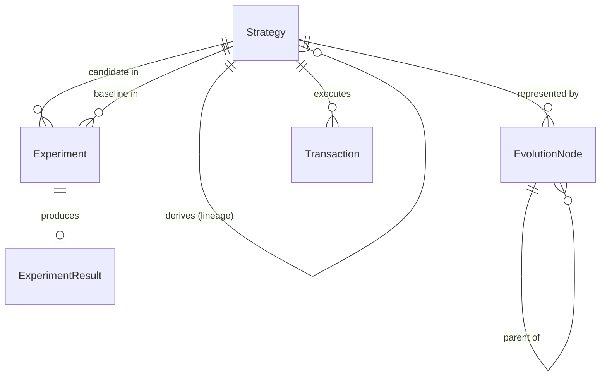

# EvolveX System Design Specification

> **Autonomous Intelligence. Continuous Evolution.**

---

## 1. Monorepo Package Topology

```text
evolvex/
├── apps/
│   ├── web/                 # Next.js 15 (App Router), Wagmi, Viem, Tailwind CSS
│   └── api/                 # Fastify backend, Zod validation, Prisma ORM
├── services/
│   └── ai-engine/           # Python FastAPI, Pydantic, modular PyTorch interface
├── packages/
│   ├── shared/              # Universal TypeScript types, interfaces & Zod schemas
│   ├── config/              # Shared compiler & linter standards
│   └── blockchain/          # Viem clients, Reactive Kopli chain definitions, ABIs
└── contracts/               # Foundry Solidity suite (Kopli & Sepolia)
```

---

## 2. Data Model & Entity Relations (Prisma)

### Core Entities:
- **`BlockchainEvent`**: Ingested log record from Reactive Network or monitored chains.
- **`Strategy`**: Algorithmic parameter vector representing an active or experimental policy.
- **`Experiment`**: Controlled A/B trial comparing a candidate strategy against a baseline.
- **`ExperimentResult`**: Statistical evaluation metrics ($p$-value, yield delta, gas savings).
- **`EvolutionNode`**: Node in the evolutionary tree tracking generational mutations.
- **`Transaction`**: On-chain execution receipts and verification records.



---

## 3. Statistical Experimentation & Fitness Evaluation

### A/B Testing Hypothesis Testing
For each experiment comparing candidate strategy $C$ against baseline $B$, we measure metric delta $\Delta \mu$:

$$\Delta \mu = \frac{\bar{Y}_C - \bar{Y}_B}{\bar{Y}_B}$$

where $\bar{Y}$ represents annualized Sharpe-adjusted net yield.

Statistical significance is calculated via two-sample Student's $t$-test:

$$t = \frac{\bar{Y}_C - \bar{Y}_B}{\sqrt{\frac{s_C^2}{n_C} + \frac{s_B^2}{n_B}}}$$

A candidate is promoted to active generation status **only if**:
1. Metric improvement $\Delta \mu > 5.0\%$
2. $p\text{-value} < 0.05$
3. Gas efficiency delta $\ge 0$
4. Zero risk guardrail violations during sample period.

---

## 4. API Specification Summary

### Fastify Backend (`apps/api` - Port 4000)
- `GET  /health` - Service health & status
- `GET  /api/events` - Monitored on-chain events
- `POST /api/events` - Ingest event payload
- `GET  /api/strategies` - Roster of strategies
- `POST /api/strategies` - Register strategy
- `GET  /api/experiments` - List of experiments
- `POST /api/experiments` - Launch A/B trial
- `GET  /api/evolution` - Generational lineage tree

### AI Decision Engine (`services/ai-engine` - Port 8000)
- `GET  /health` - Model status & service health
- `POST /analyze` - Analyze incoming Reactive event
- `POST /generate-strategy` - Synthesize mutated strategy
- `POST /evaluate-strategy` - Score fitness & enforce safety constraints

